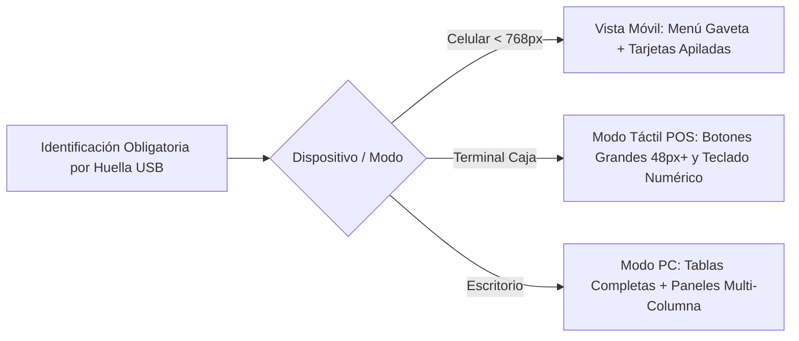
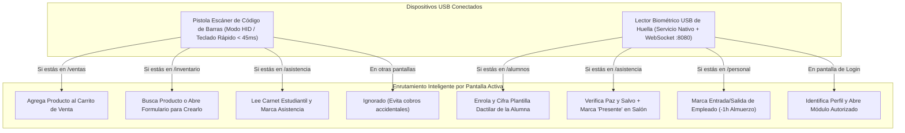
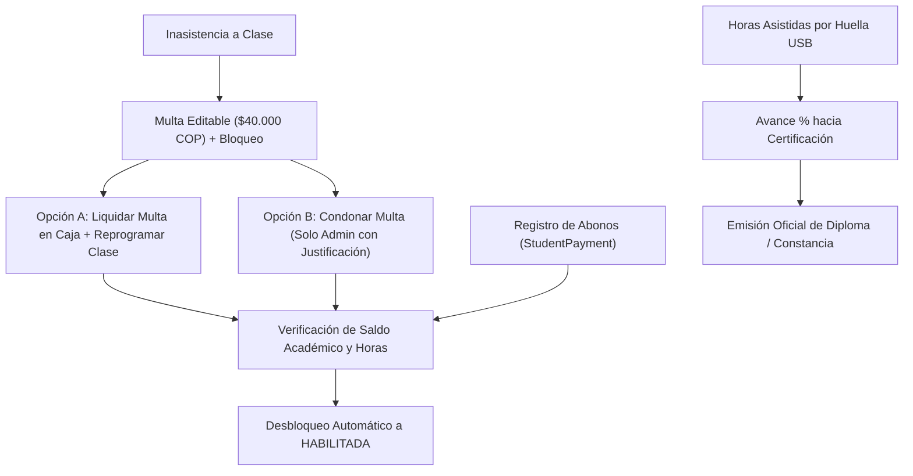
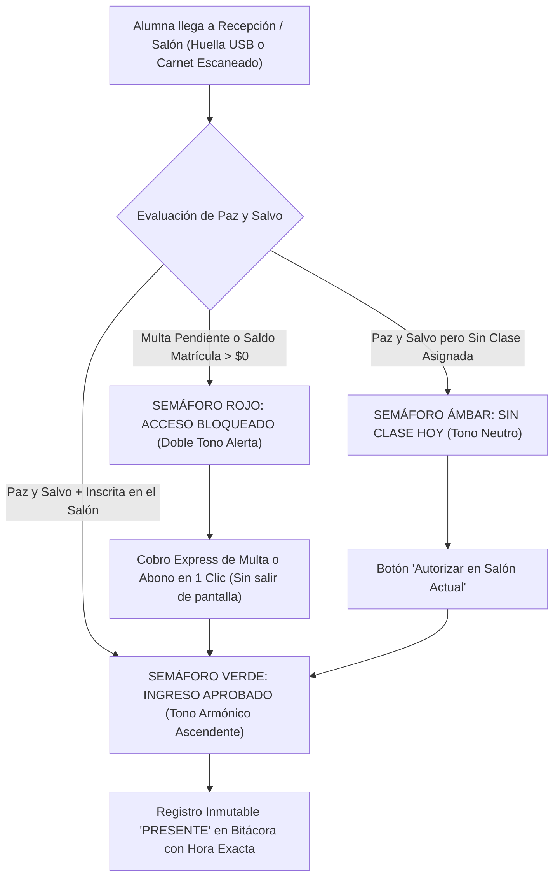
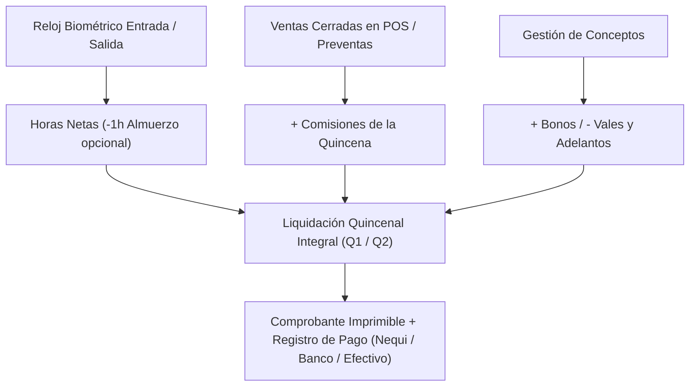
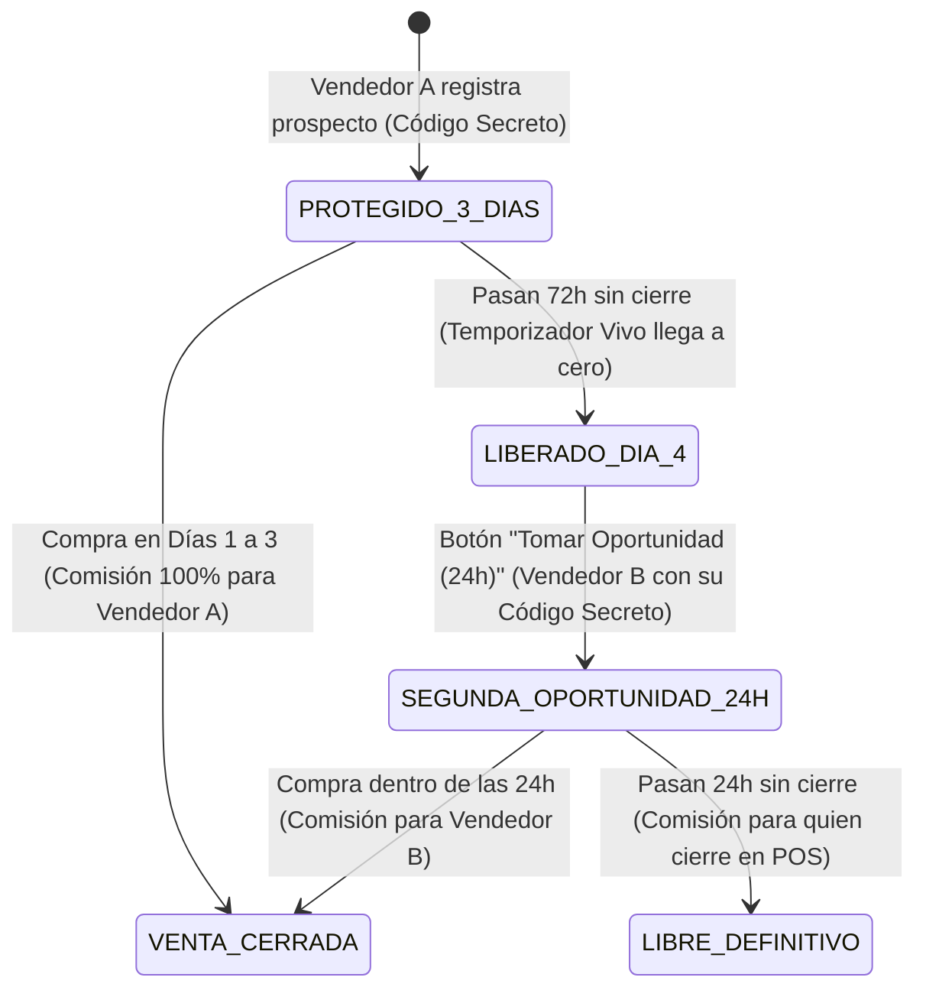
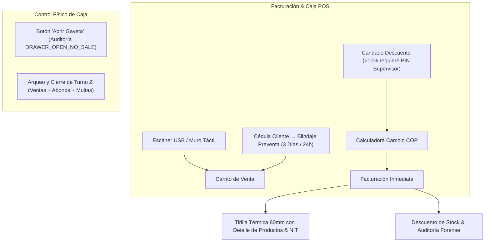
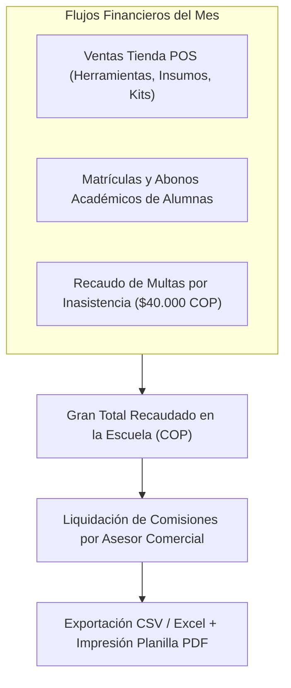
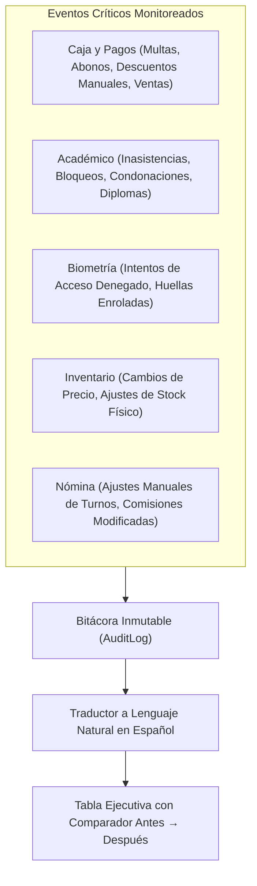

# Manual de Usuario y Guía Operativa Integral
## Escuela Profesional D' Belleza (EPB) — Sistema Académico, Biométrico y POS

> [!NOTE]
> Este manual documenta el funcionamiento paso a paso de todos los módulos desarrollados para la **Escuela Profesional D' Belleza (EPB)**, incluyendo las reglas de negocio financieras en **Pesos Colombianos (COP)**, controles biométricos y operación multi-dispositivo (**Celular / Móvil**, **Pantalla Táctil POS** y **Computador PC**).

---

## 1. Arquitectura General y Modos de Visualización (Móvil, POS y PC)

El sistema está diseñado para adaptarse en tiempo real a tres entornos de trabajo dentro de la escuela:

> [!IMPORTANT]
> **Política de Seguridad Antifraude (100% Biométrico):**
> Se eliminó el inicio de sesión por códigos o PINes numéricos para evitar que los funcionarios compartan o falsifiquen credenciales. El ingreso a la plataforma se realiza **exclusivamente colocando el dedo en el sensor biométrico USB**.

### Protocolo de Contingencia de Hardware y Fototrampa Forense
Si el lector biométrico físico sufre una avería, golpe o daño eléctrico, la institución cuenta con un **Plan de Contingencia y Fototrampa con Llave Maestra SOS**:
1. **Llave Maestra de Rectoría / Dirección General:** En la pantalla de login existe un acceso discreto: *`¿El huellero USB está dañado o desconectado? • Protocolo de Contingencia`*.
2. **Fototrampa Automática (Cámara WebRTC):**
   - Al abrir la ventana de contingencia, el navegador enciende discretamente la cámara frontal del equipo.
   - En el preciso momento en que alguien pulsa *"Activar Desbloqueo de Emergencia"*, el sistema captura una fotografía instantánea en alta resolución.
3. **Evidencia Visual en la Auditoría Forense (`LOGIN_FAILED` con Foto):**
   - Si la persona ingresó una clave incorrecta (intento de vulneración o adivinación), el sistema rechaza el intento y almacena la fotografía del intruso directamente en la Auditoría Forense (`/auditoria`), disponible para que el Administrador vea su rostro.
4. **Política de Bloqueo por Fuerza Bruta (Cooldown Progresivo):**
   - El sistema permite un margen de hasta **3 intentos** (por si el administrador comete un error tipográfico al digitar).
   - Si se cometen **3 intentos fallidos consecutivos**, el botón de contingencia se **bloquea temporalmente durante 5 minutos (300 segundos)** con un contador regresivo visible en pantalla. Durante ese tiempo nadie puede seguir probando claves.
5. **Desbloqueo Legítimo:** Si la clave es la correcta de Dirección, se habilita temporalmente la sesión para el rol solicitado y se graba la auditoría forense inmutable `HARDWARE_EMERGENCY_OVERRIDE_ACTIVATED`.
6. **Plataforma 100% Operativa:** La escuela puede seguir cobrando en caja POS, registrando asistencias y dictando clases sin interrupciones mientras el equipo técnico conecta el nuevo huellero de repuesto.

### Elementos Globales (Cabecera y Menú Lateral)
1. **Selector de Modo (`Modo PC` / `Modo Táctil POS`):** Ubicado en la barra superior ([Header.tsx](file:///c:/Users/yepes/Desktop/Escuela%20Profesional%20D'%20Belleza/src/components/layout/Header.tsx)). Al activar **`Modo Táctil POS`**, todos los botones, selectores y filas crecen de tamaño para operarse cómodamente con los dedos en monitores táctiles o tablets.
2. **Selector de Tema (`Modo Claro` / `Modo Oscuro`):** Alterna entre la estética marfil-rosada de alto contraste (`#ECCCD9` sobre `#141213`) y el modo oscuro nocturno sin pérdida de legibilidad.
3. **Estado del Lector Biométrico USB:** Indica en tiempo real si el sensor de huella está conectado (`Biometría USB Activa`).
4. **Barra Superior de Alerta de Reposición ([GlobalStockAlert.tsx](file:///c:/Users/yepes/Desktop/Escuela%20Profesional%20D'%20Belleza/src/components/layout/GlobalStockAlert.tsx)):**
   - Aparece automáticamente en la parte superior de cualquier pantalla cuando uno o más productos caen en o por debajo de su **porcentaje límite configurable**.
   - Muestra el botón **`ALERTA DE REPOSICIÓN (N)`** en PC o **`STOCK BAJO (N)`** en móvil, separando cuántos están **Agotados (0%)** y cuántos **Por Agotarse (En Límite)**.
   - Al tocar **`Ver (N)`**, despliega las tarjetas con barras de progreso individuales, mostrando la línea divisoria exacta en el `%` configurado de cada producto y cuántas unidades faltan para llegar al 100%.

---

## 2. Aclaración Clave: Integración con Dispositivos Físicos (Pistola de Barras vs. Biométrico USB)

> [!IMPORTANT]
> Para evitar confusiones operativas en recepción o caja, el sistema separa estrictamente cómo se comunican y procesan los dos dispositivos físicos conectados por USB.

### 1. ¿Cómo opera la Pistola de Código de Barras USB?
- **Protocolo de Teclado Rápido (HID):** La pistola emula un teclado ultra-rápido. Al leer una etiqueta, envía los caracteres en menos de 45 milisegundos y finaliza con un `Enter`. El hook interno ([useBarcodeScanner.ts](file:///c:/Users/yepes/Desktop/Escuela%20Profesional%20D'%20Belleza/src/hooks/useBarcodeScanner.ts)) mide la velocidad para no confundir la lectura láser con tipeo humano.
- **Aislamiento por Pantalla (Cero Ventas Accidentales):**
  - **En `/ventas` (Caja POS):** Agrega el producto al carrito de compras o suma +1 a su cantidad si ya existía.
  - **En `/inventario`:** Localiza el producto en la tabla de existencias para ver su stock actual, o si es un código nuevo, abre el modal para crearlo con el código pre-llenado.
  - **En `/asistencia`:** Si la alumna porta su carnet físico con código de barras, busca su documento e inicia el flujo de entrada al salón.
  - **En el resto de la plataforma:** El escáner es **completamente neutralizado e ignorado**, evitando ventas accidentales o búsquedas no deseadas.

### 2. ¿Cómo opera el Lector Biométrico de Huella USB y el WebSocket?
- **Canal Dedicado WebSocket (`ws://localhost:8080`):** Los lectores ópticos de huella (ej. DigitalPersona o ZKTeco) no son teclados; requieren un puente nativo que corre en el sistema operativo local y transmite eventos biométricos (`CAPTURE_SUCCESS`, `MATCH_FOUND`, `CONNECTED`) mediante [useFingerprint.ts](file:///c:/Users/yepes/Desktop/Escuela%20Profesional%20D'%20Belleza/src/hooks/useFingerprint.ts).
- **Procesamiento de Seguridad:** Cada pantalla utiliza la huella únicamente para el fin correspondiente (inicio de sesión, validación de deudas al entrar al aula o enrolamiento de nuevas alumnas), garantizando que no se crucen las operaciones.

---

## 3. Módulo 1: Ingreso Biométrico y Control de Acceso

**Archivo principal:** [BiometricAccessScreen.tsx](file:///c:/Users/yepes/Desktop/Escuela%20Profesional%20D'%20Belleza/src/components/layout/BiometricAccessScreen.tsx)

### ¿Cómo funciona?
- **Por Huella Dactilar:** El usuario coloca su dedo en el lector USB y el sistema identifica automáticamente su perfil y lo redirige a su módulo principal autorizado.
- **Por Código Personal de Acceso:** Cada integrante tiene un código único (ej. `ADMIN-01`, `ASESOR-01`, `VENTA-01`, `PROF-01`, `CONTA-01`).
- **Tarjetas de Acceso Rápido (Demo / Operación Rápida):** En pantalla aparecen los perfiles activos para iniciar sesión con un solo toque durante pruebas o cambios rápidos de turno en recepción.
- **Validación de Caducidad Temporal:** Si un usuario de **Contabilidad / Invitado** intenta ingresar después de la fecha/hora límite que le asignó Dirección, el sistema bloquea el acceso automáticamente.

---

## 4. Módulo 2: Agendas por Salón (`/agenda`)

**Archivos principales:** [agenda/page.tsx](file:///c:/Users/yepes/Desktop/Escuela%20Profesional%20D'%20Belleza/src/app/(dashboard)/agenda/page.tsx) • [RoomScheduleBoard.tsx](file:///c:/Users/yepes/Desktop/Escuela%20Profesional%20D'%20Belleza/src/components/schedules/RoomScheduleBoard.tsx) • [CreateScheduleDialog.tsx](file:///c:/Users/yepes/Desktop/Escuela%20Profesional%20D'%20Belleza/src/components/schedules/CreateScheduleDialog.tsx) • [ManageScheduleModal.tsx](file:///c:/Users/yepes/Desktop/Escuela%20Profesional%20D'%20Belleza/src/components/schedules/ManageScheduleModal.tsx)

### ¿Cómo funciona paso a paso?
1. **Creación y Edición de Salones Físicos ([CreateRoomDialog.tsx](file:///c:/Users/yepes/Desktop/Escuela%20Profesional%20D'%20Belleza/src/components/schedules/CreateRoomDialog.tsx)):**
   - Permite crear salones (ej. *Salón 101 - Cosmetología Facial*, *Salón 102 - Uñas & Nail Art*, *Salón 103 - Peluquería & Colorimetría*) definiendo su código único, capacidad máxima de alumnas (con botones rápidos de 8 a 25 personas) y equipamiento.
   - Al seleccionar un salón en el tablero, puedes ajustar su **Capacidad (Personas)** en caliente con un clic.
2. **Validación Anti-Cruce de Salón y Docente en Tiempo Real:**
   - Tanto en el formulario en vivo como en el servidor ([api/schedules/route.ts](file:///c:/Users/yepes/Desktop/Escuela%20Profesional%20D'%20Belleza/src/app/api/schedules/route.ts)), el sistema verifica que:
     - El **Salón Físico** no esté ocupado por otra clase activa en ese mismo rango de fecha y hora.
     - El **Docente** no tenga asignada otra clase en otro salón a esa misma hora.
   - Si detecta un cruce, muestra una alerta indicando exactamente con qué clase, salón y docente se cruza.
3. **Selectores Táctiles de Horario y Programación Recurrente / Duplicación:**
   - **Bloques Horarios de 1 Clic:** *Mañana (08:00 - 12:00)*, *Tarde (14:00 - 18:00)*, *Noche (18:00 - 21:00)* e *Intensivo (08:00 - 16:00)*.
   - **Frecuencia de Repetición:** Permite publicar la clase **Solo ese día (1 sesión)**, **3 Días seguidos**, **5 Días (Lun-Vie)** o **4 Semanas consecutivas**, matriculando automáticamente al grupo seleccionado en todas las sesiones y validando que no existan cruces en ninguna de las fechas.
   - **Botón `Duplicar Clase`:** Desde cualquier tarjeta del cronograma o dentro del detalle de la clase, puedes tocar **`Duplicar`** para clonar la clase (con su salón, docente, materia y alumnas inscritas) hacia una nueva fecha.
4. **Inscripción Rápida por Grupo de Programa Académico:**
   - Incluye el botón **`+ Inscribir Grupo de este Programa`**, que selecciona automáticamente a todas las alumnas habilitadas matriculadas en esa carrera hasta completar el cupo máximo del salón.
5. **Control de Asistencia Estrictamente Individual por Huella:**
   - La asistencia en el salón se valida **individualmente alumna por alumna** mediante biometría (sin botones masivos que salten el control de huella).
   - Cada tarjeta del cronograma muestra en vivo los contadores verificados: `✓ Presentes`, `✕ Ausentes (Multadas)` y `Pendientes por huella`.
6. **Desactivación Auditada con Motivo Obligatorio:**
   - Ninguna clase se desactiva sin rastro. Si un Administrador suspende una sesión, el sistema exige escribir el **motivo de desactivación**, guardando el autor y la fecha/hora en la Auditoría Forense.

---

## 4. Módulo 3: Alumnos, Multas, Abonos, Biometría y Certificados (`/alumnos`)

**Archivos principales:** [alumnos/page.tsx](file:///c:/Users/yepes/Desktop/Escuela%20Profesional%20D'%20Belleza/src/app/(dashboard)/alumnos/page.tsx) • [StudentsFinesPanel.tsx](file:///c:/Users/yepes/Desktop/Escuela%20Profesional%20D'%20Belleza/src/components/students/StudentsFinesPanel.tsx) • [PayFineModal.tsx](file:///c:/Users/yepes/Desktop/Escuela%20Profesional%20D'%20Belleza/src/components/students/PayFineModal.tsx) • [RegisterStudentPaymentModal.tsx](file:///c:/Users/yepes/Desktop/Escuela%20Profesional%20D'%20Belleza/src/components/students/RegisterStudentPaymentModal.tsx) • [EnrollFingerprintModal.tsx](file:///c:/Users/yepes/Desktop/Escuela%20Profesional%20D'%20Belleza/src/components/students/EnrollFingerprintModal.tsx) • [StudyCertificateModal.tsx](file:///c:/Users/yepes/Desktop/Escuela%20Profesional%20D'%20Belleza/src/components/students/StudyCertificateModal.tsx)

### Funcionalidades y Mejoras Implementadas:
1. **Ficha Académica, Financiera y Biometría de la Alumna:**
   - Registra nombre completo, documento de identidad (con validación de duplicados amigable), teléfono, correo, programa técnico matriculado y **saldo académico pendiente en COP** (con desglose de motivo, ej. *Cuota 2 de matrícula*).
2. **Registro de Abonos y Pagos Parciales ([RegisterStudentPaymentModal.tsx](file:///c:/Users/yepes/Desktop/Escuela%20Profesional%20D'%20Belleza/src/components/students/RegisterStudentPaymentModal.tsx)):**
   - Permite abonar al saldo de la alumna en cualquier momento sin tener que editar la ficha a mano.
   - Atajos rápidos de pago: **Saldar Total (100%)**, **50%**, **\$50.000** o **\$100.000**.
   - Admite medios de pago: **Efectivo**, **Transferencia (Nequi / Daviplata / Bancolombia)**, **Tarjeta** o **Mixto**, junto a la referencia de transacción y notas.
   - Genera un **Comprobante de Abono Oficial Imprimible** con número de recibo consecutivo (`REC-EPB-XXXXXX`) y actualiza el saldo pendiente en tiempo real. Si el saldo llega a cero y no hay multas, desbloquea automáticamente a la alumna.
3. **Bloqueo Blindado por Inasistencia y Cobro de Multas ([PayFineModal.tsx](file:///c:/Users/yepes/Desktop/Escuela%20Profesional%20D'%20Belleza/src/components/students/PayFineModal.tsx)):**
   - Cuando una alumna falta, genera la multa (configurable o \$40.000 COP) y bloquea su acceso biométrico.
   - **Blindaje Financiero:** Se previene cualquier sobreescritura accidental sobre multas que ya hayan sido pagadas previamente.
   - **Doble condición de liquidación:** El pago exige asignar una clase de reposición obligatoria para recuperar la práctica perdida.
4. **Condonación / Anulación de Multas (Exclusivo Administrador):**
   - Desde la misma ventana de multa, un Administrador puede seleccionar **`Condonar / Anular Multa (Admin)`**.
   - Exige escribir una **justificación obligatoria** (ej. *Incapacidad médica certificada por EPS* o *Autorización de Rectoría*).
   - Coloca la multa en estado `ANULADA`, desbloquea a la estudiante si no tiene más deudas y deja registro inalterable en la Auditoría Forense (`FINE_CANCELLED`).
5. **Enrolamiento Biométrico Dactilar USB ([EnrollFingerprintModal.tsx](file:///c:/Users/yepes/Desktop/Escuela%20Profesional%20D'%20Belleza/src/components/students/EnrollFingerprintModal.tsx)):**
   - Distingue con badges de color entre alumnas **Con Huella Enrolada** (verde) y **Sin Huella** (ámbar).
   - Permite capturar o re-enrolar la huella dactilar directamente desde los lectores USB compatibles (DigitalPersona, ZKTeco), vinculando la plantilla biométrica cifrada a la alumna.
6. **Control de Horas Técnicas Asistidas y Bloqueo de Grado ([StudyCertificateModal.tsx](file:///c:/Users/yepes/Desktop/Escuela%20Profesional%20D'%20Belleza/src/components/students/StudyCertificateModal.tsx)):**
   - Cada tarjeta de alumna calcula y muestra en vivo sus **horas asistidas reales vs las horas mínimas del programa** (ej. 600h para Cosmetología, 300h para Peluquería, 120h para Diplomados) y su porcentaje de cumplimiento.
   - Al intentar emitir el **Diploma de Graduación**, el sistema verifica tanto el paz y salvo de deudas como el cumplimiento del 100% de las horas requeridas. Si no cumple las horas, restringe la emisión con una Alerta Académica (solo levantable por Dirección con autorización especial de auditoría).
7. **Cobro Directo por WhatsApp de 1 Clic:**
   - Cada alumna con saldo pendiente o multa activa cuenta con el botón **`Cobro WhatsApp`**.
   - Abre un chat directo (`https://wa.me/57...`) con un **mensaje cortés pre-llenado en COP**, detallando el desglose de su deuda (saldo académico y multas) e indicando los canales oficiales de transferencia (Nequi / Bancolombia EPB) para facilitar el recaudo.
8. **Filtros Avanzados y Ordenamiento Rápido:**
   - **Filtro por Programa:** Permite filtrar rápidamente por carrera técnica (Cosmetología, Uñas, Colorimetría, etc.).
   - **Ordenamiento Inteligente:** Permite ordenar por *Mayor Deuda Primero*, *Nombre Alfabético*, *Menor Avance de Horas* o *Sin Huella Primero*.

---

## 6. Módulo 4: Terminal de Asistencia Biométrica, Semáforo y Modo Kiosco (`/asistencia`)

**Archivos principales:** [asistencia/page.tsx](file:///c:/Users/yepes/Desktop/Escuela%20Profesional%20D'%20Belleza/src/app/(dashboard)/asistencia/page.tsx) • [BiometricAttendanceTerminal.tsx](file:///c:/Users/yepes/Desktop/Escuela%20Profesional%20D'%20Belleza/src/components/attendance/BiometricAttendanceTerminal.tsx) • [sound.ts](file:///c:/Users/yepes/Desktop/Escuela%20Profesional%20D'%20Belleza/src/lib/sound.ts)

### Funcionalidades de la Terminal de Asistencia:
1. **Modo Kiosco / Pantalla Completa para Recepción:**
   - Botón **`Modo Kiosco`** en la cabecera: expande la terminal a pantalla completa, eliminando distracciones para colocarla en la tablet o PC de la entrada de la escuela. Permite salir con el botón **`Salir Kiosco`** en cualquier momento.
2. **Feedback Sonoro Acústico Dinámico ([sound.ts](file:///c:/Users/yepes/Desktop/Escuela%20Profesional%20D'%20Belleza/src/lib/sound.ts)):**
   - **Tono Verde (Aprobado):** Acorde armónico ascendente suave (`880Hz → 1320Hz`). La recepcionista sabe que la alumna pasó sin necesidad de mirar la pantalla.
   - **Tono Rojo (Alerta / Denegado):** Doble pulso grave descendente (`280Hz → 220Hz`), alertando inmediatamente al personal de portería/recepción.
   - **Tono Ámbar (Aviso):** Tono neutro (`550Hz`) para alumnas sin clase asignada.
   - Botón **`Audio ON / Audio OFF`** para silenciar o reactivar el sonido con un toque.
3. **Doble Validación Financiera de Entrada:**
   - Verifica tanto **multas por inasistencias pasadas** como **saldos académicos de matrícula o kit pendientes**.
   - Si la alumna debe, el semáforo muestra en rojo el desglose exacto en **Pesos Colombianos (`$ XX.XXX COP`)** y el concepto.
4. **Cobro Express de Multas y Abonos (En la Misma Terminal):**
   - Cuando el semáforo bloquea a una alumna, aparecen los botones:
     - **`Cobrar Multa Express ($40.000 COP)`**: Abre el modal de liquidación y reposición de clase. Al registrar el pago en efectivo, tarjeta o Nequi, la alumna queda habilitada de inmediato para volver a poner el dedo y entrar al salón.
     - **`Abonar Saldo ($ COP)`**: Abre el recibo de abono con actualización en caliente.
5. **Enrutamiento Inteligente por Salón:**
   - La terminal detecta automáticamente en qué salón está matriculada la alumna hoy, marcándole la asistencia en el aula que le corresponde sin necesidad de seleccionarla a mano.
6. **Bitácora de Llegadas en Vivo:**
   - Panel lateral derecho que lista en tiempo real las últimas 15 alumnas que han ingresado, su salón, la hora exacta en formato colombiano y el método (*Huella* vs *Cédula/Carnet*).

---

## 6. Módulo 5: Personal de Planta y Liquidación Quincenal (`/personal`)

**Archivos principales:** [personal/page.tsx](file:///c:/Users/yepes/Desktop/Escuela%20Profesional%20D'%20Belleza/src/app/(dashboard)/personal/page.tsx) • [StaffFortnightPanel.tsx](file:///c:/Users/yepes/Desktop/Escuela%20Profesional%20D'%20Belleza/src/components/staff/StaffFortnightPanel.tsx) • [StaffMemberFormModal.tsx](file:///c:/Users/yepes/Desktop/Escuela%20Profesional%20D'%20Belleza/src/components/staff/StaffMemberFormModal.tsx) • [ManualTimeLogModal.tsx](file:///c:/Users/yepes/Desktop/Escuela%20Profesional%20D'%20Belleza/src/components/staff/ManualTimeLogModal.tsx) • [PayrollAdjustmentModal.tsx](file:///c:/Users/yepes/Desktop/Escuela%20Profesional%20D'%20Belleza/src/components/staff/PayrollAdjustmentModal.tsx) • [StaffPayStubModal.tsx](file:///c:/Users/yepes/Desktop/Escuela%20Profesional%20D'%20Belleza/src/components/staff/StaffPayStubModal.tsx)

### Funcionalidades paso a paso:
1. **Definición de Tipos de Empleado y Valor Hora en COP ([StaffMemberFormModal.tsx](file:///c:/Users/yepes/Desktop/Escuela%20Profesional%20D'%20Belleza/src/components/staff/StaffMemberFormModal.tsx)):**
   - Clasifica al personal en 5 categorías con código de color:
     - **Docente / Profesor (`PROFESOR`)**
     - **Asesor Académico / Recepción (`ASESOR`)**
     - **Ejecutivo de Ventas POS (`VENTA`)**
     - **Dirección / Administración (`ADMIN`)**
     - **Contabilidad / Auditoría (`CONTABILIDAD`)**
   - Define el **Valor por Hora en COP** individual con botones de tarifas sugeridas y proyección automática de pago por turno (8h) y por quincena (96h), además de su `% de comisión` sobre ventas.
2. **Reloj Biométrico de Entrada y Salida con Descuento de Almuerzo:**
   - **Marcación Rápida (`AUTO`):** Al digitar la cédula o código del empleado en la barra superior, el sistema detecta si está entrando (`ENTRADA`) o saliendo (`SALIDA`).
   - **Tarjetas por Empleado:** Muestran en vivo quién está **`EN TURNO`** con indicador verde pulsante y hora de ingreso.
   - **Botón `-1h Almuerzo` en Turno Activo:** Antes de marcar `Salida`, se puede activar con un toque **`Descontar 1h almuerzo`** para restar automáticamente 60 minutos en jornadas continuas (ej. 8:00 AM a 5:00 PM = 8.0 horas netas pagables).
3. **Alerta Automática de Turnos Olvidados (`+10 Horas Abiertos`):**
   - Si un empleado olvidó marcar su salida y el turno supera las 10 horas abierto, aparece un banner amarillo en la parte superior con un botón de 1 clic **`Cerrar Turno de [Nombre]`**, permitiendo ajustar la hora real en que salió para evitar sobrecostos.
4. **Registro Manual de Turnos ([ManualTimeLogModal.tsx](file:///c:/Users/yepes/Desktop/Escuela%20Profesional%20D'%20Belleza/src/components/staff/ManualTimeLogModal.tsx)):**
   - Permite cargar turnos pasados o reposiciones de clase con atajos rápidos (*Mañana 4h*, *Tarde 4h*, *Jornada 6h*, *Completa 8h netas con -1h almuerzo*) y motivo de auditoría.
5. **Cruce Automático de Comisiones POS en la Quincena:**
   - Suma automáticamente todas las comisiones ganadas por el empleado en las ventas completadas durante esa quincena (`Q1: días 1 al 15` o `Q2: días 16 a fin de mes`).
6. **Bonos (+), Adelantos / Vales (-) y Descuentos (-) ([PayrollAdjustmentModal.tsx](file:///c:/Users/yepes/Desktop/Escuela%20Profesional%20D'%20Belleza/src/components/staff/PayrollAdjustmentModal.tsx)):**
   - Permite cargar en segundos un **Vale / Adelanto de Quincena (-)**, un **Descuento por Kit o Producto (-)** o un **Bono por Meta (+)**, actualizando el **Neto a Pagar** al instante.
7. **Cierre de Pago de Quincena (`PENDIENTE` vs `PAGADA`) y Recibo Imprimible ([StaffPayStubModal.tsx](file:///c:/Users/yepes/Desktop/Escuela%20Profesional%20D'%20Belleza/src/components/staff/StaffPayStubModal.tsx)):**
   - Permite registrar el pago seleccionando el medio (**Nequi, Bancolombia, Efectivo en Caja, Daviplata u Otra Transferencia**) y número de referencia.
   - Genera el **Comprobante Quincenal de Nómina** listo para imprimir o guardar en PDF con todo el desglose financiero y de turnos.

---

## 7. Módulo 6: Inventario, Código de Barras y Límite Configurable (`/inventario`)

**Archivos principales:** [inventario/page.tsx](file:///c:/Users/yepes/Desktop/Escuela%20Profesional%20D'%20Belleza/src/app/(dashboard)/inventario/page.tsx) • [InventoryStockTable.tsx](file:///c:/Users/yepes/Desktop/Escuela%20Profesional%20D'%20Belleza/src/components/inventory/InventoryStockTable.tsx) • [ProductFormModal.tsx](file:///c:/Users/yepes/Desktop/Escuela%20Profesional%20D'%20Belleza/src/components/inventory/ProductFormModal.tsx)

### ¿Cómo funciona?
1. **Límite de Aviso 100% Configurable (Por Producto y Global):**
   - Cada producto tiene su **Capacidad Tope 100% (Base)** (ej. `40 uds` o `50 uds`) y su **Porcentaje Límite de Aviso (`%`)** configurable entre `5%` y `90%` (con botones rápidos: `15%`, `20%`, `25%`, `30%`, `40%`, `50%`).
   - Además, desde el botón **`Configurar Límite Global (%)`** en la cabecera de inventario, puedes cambiar con un solo clic el porcentaje de alerta de todo el catálogo al mismo tiempo.
2. **Barra de Progreso de Existencias con Marcador Dinámico:**
   - Cada producto muestra una barra de progreso con una línea divisoria vertical ubicada exactamente en su `%` límite configurado, cambiando de color:
     - **Verde (`Stock Óptimo`):** Por encima del límite configurado.
     - **Ámbar (`En Zona de Alerta`):** En o por debajo del `%` límite configurado (indica cuántas unidades faltan para volver al 100%).
     - **Rojo (`0% • AGOTADO`):** Sin existencias físicas.
3. **Escáner USB de Código de Barras y Abastecimiento Rápido:**
   - El buscador detecta lecturas de pistola láser USB: si el código existe, filtra el producto para sumarle unidades; si no existe, ofrece crearlo pre-llenando el código de barras.
   - Botones de **Abastecimiento en 1 clic**: **`+20 uds`**, **`Llenar al 100% (+N)`** o cantidad personalizada.
4. **Simulador de Utilidad y Margen Unitario ([ProductFormModal.tsx](file:///c:/Users/yepes/Desktop/Escuela%20Profesional%20D'%20Belleza/src/components/inventory/ProductFormModal.tsx)):**
   - Al crear o editar un producto, calcula en tiempo real la **Utilidad en COP por unidad** y el **`%` de margen de ganancia** entre el Costo Base y el Precio de Venta.

---

## 8. Módulo 7: Preventas, Blindaje de Clientes, Temporizador Vivo y Bitácora (`3 Días / 4to Día / 24h`) (`/preventas`)

**Archivos principales:** [preventas/page.tsx](file:///c:/Users/yepes/Desktop/Escuela%20Profesional%20D'%20Belleza/src/app/(dashboard)/preventas/page.tsx) • [PresalesProtectionBoard.tsx](file:///c:/Users/yepes/Desktop/Escuela%20Profesional%20D'%20Belleza/src/components/sales/PresalesProtectionBoard.tsx)

### ¿Cómo funciona el Blindaje Comercial y la Reclamación de Prospectos?
1. **Días 1 a 3 (`PROTEGIDO_3_DIAS` - Ventana de 72 horas):**
   - Cuando el **Vendedor A** atiende por primera vez a un prospecto y lo registra con su **Código Secreto de Vendedor** (ej: `LAURA-777`), el cliente queda blindado a su nombre durante **72 horas exactas**.
   - Aunque otro cajero o vendedor facture al cliente en el POS durante esos 3 días, **la comisión se le asigna automáticamente al Vendedor A**.
   - El tablero muestra un **reloj regresivo en tiempo real (`Quedan: 2d 14h 22m` o `HH:MM:SS`)** para saber con exactitud cuánto tiempo de protección le resta.
2. **4to Día (`LIBERADO_DIA_4`): Reclamación con 1 Clic para Segundo Vendedor:**
   - Si transcurren los 3 días sin concretarse la venta, el cliente pasa a estado **Liberado Día 4** (considerado prospecto sin atención previa).
   - En este estado se activa el botón ámbar **`Tomar Oportunidad (24h)`**: cualquier otro asesor (ej. `CAMILA-888`) puede reclamar al prospecto ingresando su código secreto y una nota de contacto opcional.
   - Al confirmarlo, el sistema inicia automáticamente una **ventana exclusiva de 24 horas (`SEGUNDA_OPORTUNIDAD_24H`)** a favor del segundo vendedor y registra la auditoría forense `PRESALE_SELLER_TRANSFERRED`.
3. **Piscina Libre tras 24h sin Cierre (`LIBRE_DEFINITIVO`):**
   - Si en esa segunda oportunidad tampoco se concreta la venta en 24 horas, el cliente ingresa a **Piscina Libre**: cualquier vendedor que concrete la venta en la caja POS recibirá la comisión.
4. **Bitácora Comercial y Seguimiento (Llamadas / WhatsApp):**
   - Cada prospecto cuenta con un botón **`Bitácora`** que abre el historial completo de interacciones con fecha y hora.
   - Permite llamadas directas (`tel:`) y envío de mensajes por WhatsApp (`https://wa.me/57...`) en un clic desde el celular o tablet.
   - Los asesores pueden registrar notas breves (ej: *"Se envió cotización de kit", "Pidió que la llamáramos el jueves a las 3pm"*), manteniendo la trazabilidad del cliente entre turnos.

---

## 9. Módulo 8: Caja Registradora POS, Facturación Térmica 80mm y Arqueo Z (`/ventas`)

**Archivos principales:** [ventas/page.tsx](file:///c:/Users/yepes/Desktop/Escuela%20Profesional%20D'%20Belleza/src/app/(dashboard)/ventas/page.tsx) • [PosBarcodeCheckout.tsx](file:///c:/Users/yepes/Desktop/Escuela%20Profesional%20D'%20Belleza/src/components/sales/PosBarcodeCheckout.tsx) • [CashRegisterModal.tsx](file:///c:/Users/yepes/Desktop/Escuela%20Profesional%20D'%20Belleza/src/components/sales/CashRegisterModal.tsx) • [ThermalTicketModal.tsx](file:///c:/Users/yepes/Desktop/Escuela%20Profesional%20D'%20Belleza/src/components/sales/ThermalTicketModal.tsx)

### ¿Cómo funciona la Terminal POS y la Caja Registradora?
1. **Lectura Inmediata por Pistola Láser USB y Muro Táctil POS:**
   - Detecta la pistola de código de barras USB de forma continua sin tener que hacer clic en el buscador. Al pistolear, agrega el producto o incrementa su cantidad al instante.
   - Cuenta con muro de botones táctiles agrupados por categoría, filtrado rápido y etiquetas de stock en tiempo real.
2. **Blindaje de Comisiones Automatizado (Regla de 3 Días y 24 Horas):**
   - Al digitar la cédula del cliente, el sistema consulta en microsegundos el historial de preventas:
     - Si está dentro de los **3 días de protección**, la comisión se acredita al **Vendedor Inicial (Asesor A)**, sin importar qué cajero esté cobrando en la máquina.
     - Si está en **segunda oportunidad (24h)**, se acredita al **Segundo Asesor**.
     - Si está liberado, se asigna al cajero que cierra la factura.
3. **Candado Biométrico Antifraude en Descuentos (> 10%):**
   - Para evitar fugas de dinero y falsificación de identidad mediante PINes aprendidos, el cajero puede aplicar descuentos libres hasta el **10%** del valor de la compra.
   - Si se digita un descuento superior al 10%, el sistema bloquea inmediatamente la transacción y **exige la confirmación por huella dactilar de un Administrador / Supervisor** en el lector USB físico. Queda grabado inmutablemente en Auditoría (`DISCOUNT_APPLIED`) el funcionario exacto que puso el dedo.
4. **Identificación de Cajero por Huella USB:**
   - La caja no opera con códigos o contraseñas que puedan ser compartidos o suplantados. El cajero activo se autentica mediante su huella biométrica USB certificada.
5. **Apertura de Gaveta de Dinero Blindada por Huella ("No Sale"):**
   - El botón **`Abrir Gaveta`** no abre el cajón monedero a ciegas: activa el sensor biométrico para que el cajero o supervisor certifique con su huella la necesidad de apertura, dejando registrada la auditoría forense `DRAWER_OPEN_NO_SALE`.
6. **Arqueo y Cierre Diario Z Sellado por Huella ([CashRegisterModal.tsx](file:///c:/Users/yepes/Desktop/Escuela%20Profesional%20D'%20Belleza/src/components/sales/CashRegisterModal.tsx)):**
   - El responsable del cuadre físico firma digitalmente el cierre del turno mediante su huella dactilar en el sensor USB, impidiendo que una persona cierre a nombre de otra.
7. **Calculadora de Efectivo en COP con Botones Rápidos de Billetes:**
   - Botones rápidos colombianos: **`$20.000`**, **`$50.000`**, **`$100.000`**, **`$150.000`**, **`$200.000`** y **`Exacto`**.
   - Muestra en grande el **Cambio a Devolver al Cliente** en verde para evitar confusiones al entregar las vueltas.
8. **Tirilla Térmica POS Estándar 80mm con Datos Oficiales e Ítems Vendidos ([ThermalTicketModal.tsx](file:///c:/Users/yepes/Desktop/Escuela%20Profesional%20D'%20Belleza/src/components/sales/ThermalTicketModal.tsx)):**
   - Diseñada especialmente para rollos e impresoras térmicas de **80mm**:
     - **Encabezado Institucional:** Razón social (*Escuela Profesional D' Belleza*), NIT (`900.584.219-4`), sede principal en Medellín, teléfonos y WhatsApp institucional.
     - **Trazabilidad:** Número de factura POS (`EPB-XXXXXX`), fecha y hora exacta, nombre y documento del cliente, cajero que facturó y asesor al que se le comisiona.
     - **Tabla Detallada de Productos:** Descripción de cada producto vendido, código de barras, cantidad unitaria y subtotal de la línea.
     - **Liquidación:** Subtotal bruto, descuento aplicado, valor total cancelado y medio de pago (**Efectivo, Nequi/Transferencia, Tarjeta o Mixto**).
     - **Pie Legal:** Leyendas DIAN régimen simplificado y aviso de garantía para productos y herramientas de belleza.
6. **Apertura de Gaveta de Dinero Registrada ("No Sale"):**
   - Botón directo en la barra superior **`Abrir Gaveta`** para abrir el cajón monedero físico o probar apertura. Cada pulsación queda grabada inmutablemente en Auditoría (`DRAWER_OPEN_NO_SALE`) indicando qué usuario la abrió.
7. **Arqueo y Cierre Diario de Caja / Reporte Z ([CashRegisterModal.tsx](file:///c:/Users/yepes/Desktop/Escuela%20Profesional%20D'%20Belleza/src/components/sales/CashRegisterModal.tsx)):**
   - Botón **`Arqueo y Cierre Z`** que consolida en tiempo real todo el flujo de dinero que ingresó a la escuela durante el día o turno:
     - **Ventas Mostrador:** Efectivo, Transferencias (Nequi/Daviplata) y Tarjeta.
     - **Abonos de Alumnos:** Pagos de matrícula, cuotas académicas y kits.
     - **Multas Recaudadas:** Cobros de inasistencias en mostrador.
   - **Termómetro de Cuadre:** El cajero ingresa el dinero físico contado en la gaveta y el sistema calcula en vivo la diferencia:
     - `CUADRE EXACTO ($0 COP)` en verde.
     - `SOBRANTE (+ $ XX COP)` en azul.
     - `FALTANTE (- $ XX COP)` en rojo.
   - Al confirmar con el código del cajero, se genera el **Comprobante de Cierre Z (80mm)** imprimible y se graba la auditoría inmutable `CASH_REGISTER_Z_REPORT`.

---

## 10. Módulo 9: Reportes Mensuales, Liquidación de Comisiones y Exportación CSV (`/reportes`)

**Archivos principales:** [reportes/page.tsx](file:///c:/Users/yepes/Desktop/Escuela%20Profesional%20D'%20Belleza/src/app/(dashboard)/reportes/page.tsx) • [MonthlyCommissionsReport.tsx](file:///c:/Users/yepes/Desktop/Escuela%20Profesional%20D'%20Belleza/src/components/sales/MonthlyCommissionsReport.tsx)

### ¿Cómo funciona el Módulo de Reportes?
1. **Panorama Financiero Consolidado de la Escuela:**
   - **Ventas POS:** Sumatoria total de compras facturadas en mostrador.
   - **Abonos Académicos:** Cuotas de matrícula, kits y pagos de pensiones.
   - **Multas Recaudadas:** Total recaudado por inasistencias a clase ($40.000 COP c/u).
   - **Gran Total Recaudado:** Muestra el flujo de caja bruto exacto de la institución durante el período contable seleccionado (`YYYY-MM`).
2. **Desglose por Carreras y Programas Técnicos:**
   - Presenta el volumen de alumnas matriculadas por cada especialidad (*Cosmetología, Uñas Acrílicas, Peluquería, Colorimetría*), facilitando la toma de decisiones directivas.
3. **Planilla de Liquidación de Comisiones por Asesor Comercial:**
   - Consolida por cada vendedor: Cédula, número de ventas cerradas, porcentaje comisionable (`%`), volumen total facturado y **monto de comisión en COP a liquidar**.
   - Totalmente alineado con la regla de **blindaje de 3 días (72h)**, **segunda oportunidad al 4to día (24h)** y cierres libres.
4. **Exportación a Excel / CSV en 1 Clic:**
   - Botón **`Exportar CSV / Excel`** que descarga la planilla lista para importar en software contable o pagar por nómina bancaria con separadores legibles y codificación UTF-8 BOM.
5. **Impresión Directa PDF:**
   - Botón **`Imprimir PDF`** formateado para reportes ejecutivos limpios.

---

## 11. Módulo 10: Auditoría Forense (`/auditoria`) y Roles / Accesos (`/usuarios`)

**Archivos principales:** [auditoria/page.tsx](file:///c:/Users/yepes/Desktop/Escuela%20Profesional%20D'%20Belleza/src/app/(dashboard)/auditoria/page.tsx) • [AuditTrailTable.tsx](file:///c:/Users/yepes/Desktop/Escuela%20Profesional%20D'%20Belleza/src/components/audit/AuditTrailTable.tsx) • [usuarios/page.tsx](file:///c:/Users/yepes/Desktop/Escuela%20Profesional%20D'%20Belleza/src/app/(dashboard)/usuarios/page.tsx) • [UserAccessManager.tsx](file:///c:/Users/yepes/Desktop/Escuela%20Profesional%20D'%20Belleza/src/components/users/UserAccessManager.tsx)

### ¿Cómo funciona la Auditoría Forense (`/auditoria`)?
1. **Lectura 100% en Español Ejecutivo (Cero JSON Crudo en Tabla):**
   - Cada evento técnico de la base de datos se traduce automáticamente a una oración clara en español, mostrando el nombre de la alumna, producto o empleado afectado y formateando las cifras en **Pesos Colombianos (`$ XX.XXX COP`)**.
2. **Catálogo Exhaustivo de Actividades Auditadas Automáticamente:**
   - **Dinero, Caja y Recaudos:**
     - `FINE_PAID`: Recaudo de multa con medio de pago y referencia.
     - `STUDENT_PAYMENT_REGISTERED`: Abono a matrícula/pensión con saldo restante.
     - `DISCOUNT_APPLIED`: Aplicación de descuento manual en caja POS con monto y responsable.
     - `VOID_SALE`: Anulación de factura POS con retorno de stock.
     - `CASH_DRAWER_OPENED`: Apertura manual de gaveta de dinero sin venta.
     - `CASH_COUNT_REGISTERED`: Cierre y arqueo de caja de la jornada.
   - **Académico y Estudiantes:**
     - `FINE_CREATED`: Inasistencia con multa automática y bloqueo preventivo.
     - `FINE_CANCELLED`: Condonación autorizada por Dirección con motivo obligatorio.
     - `STUDENT_UNBLOCKED`: Desbloqueo tras liquidación o autorización.
     - `STUDENT_ACCESS_DENIED`: Alerta de intento de ingreso a salón por huella con deuda activa.
     - `STUDENT_FINGERPRINT_ENROLLED`: Captura y cifrado de plantilla biométrica USB.
     - `CERTIFICATE_ISSUED`: Expedición oficial de diploma con código institucional.
     - `CERTIFICATE_BLOCKED_ATTEMPT`: Alerta por intento de expedición sin cumplir horas o con deuda.
   - **Inventario y Precios:**
     - `STOCK_ADJUSTED`: Modificación de existencias físicas o cambio de límites de aviso.
     - `PRODUCT_PRICE_CHANGED`: Modificación de precio de venta o costo base.
     - `STOCK_SCRAP_REGISTERED`: Baja de producto por merma, rotura o vencimiento.
   - **Personal, Nómina y Preventas:**
     - `STAFF_TIME_MANUALLY_ADJUSTED`: Registro o edición manual de turnos por administración.
     - `COMMISSION_RATE_CHANGED`: Modificación del porcentaje de comisión del vendedor.
     - `PRESALE_SELLER_TRANSFERRED`: Cliente liberado en 4to día tomado por un segundo vendedor.
     - `SCHEDULE_DEACTIVATED`: Suspensión de clase con motivo obligatorio.
3. **Tarjetas de Criticidad y Filtros por Módulo en Español:**
   - **Tarjetas Superiores:** Permiten filtrar con un clic entre *Total Eventos Auditados*, *Dinero, Caja y Pagos*, *Bloqueos y Alertas*, y *Académico e Inventario*.
   - **Píldoras de Módulos Traducidas:** Filtra directamente por *Alumnas*, *Multas por Inasistencia*, *Abonos Académicos*, *Certificados y Diplomas*, *Asistencia Biométrica*, *Inventario y Catálogo*, *Agenda de Clases*, *Turnos de Personal*, *Ventas en Caja POS*, etc.
4. **Comparador Visual de Cambios (`Antes → Después`):**
   - En lugar de bloques de código JSON, muestra etiquetas comparativas resaltando exactamente qué cambió (por ejemplo: `Stock Físico: 9 uds → 21 uds`, `Precio de Venta: $ 45.000 → $ 50.000`, `Estado: Pendiente de Pago → Pagada`, `Bloqueada: Sí → No`).
5. **Ficha Forense Detallada con Tabla Comparativa:**
   - Al hacer clic en **`Ver Ficha`** o sobre cualquier fila, se abre una ventana ejecutiva con el resumen del evento, los datos del responsable y una tabla comparativa **Campo / Concepto | Valor Anterior | Valor Nuevo Aplicado**, marcando con la etiqueta `MODIFICADO` los valores que sufrieron cambios.
   - Incluye al final un botón desplegable oculto (*"Ver respaldo técnico JSON"*) exclusivo para soporte técnico avanzado.

### ¿Cómo funciona el Control de Roles y Pases Temporales (`/usuarios`)?
1. **Pases Temporales para Contabilidad / Invitados (`/usuarios`):**
   - Dirección puede otorgar acceso temporal al rol **`CONTABILIDAD`** por **24 horas, 48 horas, 7 días** o fecha personalizada, o revocarlo de inmediato con 1 clic.
